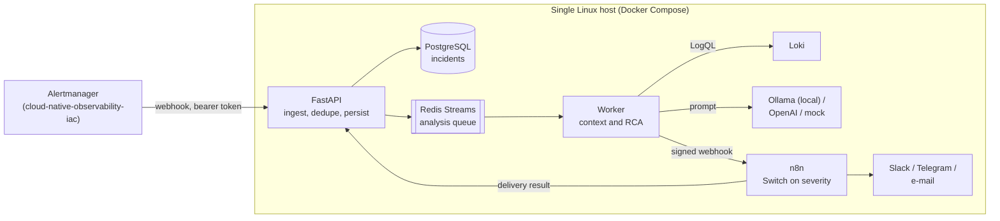

# AIOps Incident Engine

[](https://github.com/ali-fakhrabadi/aiops-n8n-incident-engine/actions/workflows/ci.yml)

An async Python service and a self-hosted n8n that turn Prometheus alerts into triaged
incidents: each alert is enriched with the matching Loki logs, analysed by an LLM
(local Ollama by default, OpenAI optional, or a deterministic mock for CI and reviewers)
for a probable root cause and **safe, read-only diagnostic commands**, and routed by n8n
to the right channel by severity. Everything runs on one Linux host; with Ollama, no
alert or log line leaves it.

> **Status: phase 1 of 5 (foundation).** The service skeleton, the hardened container
> stack (API, PostgreSQL, Redis, n8n), migrations, observability endpoints, tests and CI
> are in place. Alert ingestion, the AI analysis and the n8n workflow follow in the next
> phases; see the [roadmap](#roadmap).

## Architecture



Planned design, built phase by phase:

* **FastAPI owns correctness**: validation, idempotent ingestion (Alertmanager
  fingerprints), incident state in PostgreSQL, retries through a Redis Streams consumer
  group. **n8n owns routing**, where it is easiest to change: which channel, which
  format, who is on call.
* **LLM output is advice, never action.** Suggested commands pass an allowlist of
  read-only diagnostics and are never executed. Logs are untrusted input to the prompt.
* **Deterministic mock analyser**, so CI and reviewers run the whole pipeline without an
  API key or a GPU.

## Phase 1: what is here

| Area | Details |
|---|---|
| Service | Python 3.12, FastAPI on Uvicorn (uvloop, httptools), Pydantic v2 settings, application factory |
| Data | SQLAlchemy 2 async engine on asyncpg, Alembic migrations shipped inside the package |
| Probes | `/health/live` (process only) and `/health/ready` (PostgreSQL, Redis, migrations at head; 503 otherwise) |
| Metrics | `/metrics` behind a bearer token: requests and latency per route template, process and build info |
| Errors | RFC 9457 `application/problem+json` for every error, with the request ID; validation errors never echo input |
| Logging | One JSON object per line, request ID on every line, credentials redacted at any depth |
| Stack | API, one-shot migrations, PostgreSQL 17, Redis 7, n8n 2.45 (digest-pinned), on an internal network |
| Quality | Ruff, strict mypy, pytest with real PostgreSQL and Redis, pip-audit, ShellCheck, Trivy, end-to-end smoke test in CI |

### Security baseline

* **Secrets are files**, mounted as Docker secrets (`make secrets`): they never appear in
  `.env`, `docker inspect`, image layers or process arguments. Settings read
  `AIOPS_<NAME>_FILE`; PostgreSQL, Redis and n8n read theirs the same way.
* **Least-privilege database roles**: `aiops_owner` runs migrations; the API's
  `aiops_app` reads and writes data but cannot change the schema; n8n has its own
  database and cannot open the incident database. The smoke test proves all three.
* **Hardened containers**: read-only root filesystems, all Linux capabilities dropped,
  `no-new-privileges`, non-root users, memory and CPU limits.
* **Network**: PostgreSQL and Redis sit on an internal network without internet access
  and are not published; the API and n8n listen on `127.0.0.1` only.
* **n8n stays private**: telemetry, update checks and the template gallery are off, and
  workflows cannot read the container environment.
* **Supply chain**: hash-pinned dependencies (direct ones at least a week old when
  chosen), digest-pinned n8n image, actions pinned to commit SHAs, Dependabot.

## Quick start

Requirements: Docker with Compose v2, GNU make, bash, openssl, python3.

```bash
make env secrets     # .env with defaults, generated secrets in ./secrets
make up              # build, migrate, start; waits for health checks
make smoke           # end-to-end checks of the running stack
```

| Service | URL |
|---|---|
| API docs (Swagger UI) | http://127.0.0.1:8020/docs |
| n8n | http://127.0.0.1:5678 |

On a remote host, reach both through an SSH tunnel:
`ssh -L 8020:127.0.0.1:8020 -L 5678:127.0.0.1:5678 user@host`.

## Development

| Command | What it does |
|---|---|
| `make test` | Unit and integration tests with coverage (dev container, real PostgreSQL and Redis) |
| `make lint` / `make format` | Ruff checks / fixes |
| `make typecheck` | Strict mypy over the code, tests and scripts |
| `make audit` | pip-audit of the locked runtime dependencies |
| `make ci` | All of the above, as CI runs them |
| `make lock` | Re-resolve and hash-pin `requirements*.txt` (`PIP_INDEX_URL` for a mirror) |
| `make revision MESSAGE="..."` | Autogenerate an Alembic migration |

## Roadmap

1. **Foundation** (done): service skeleton, container stack, migrations, probes,
   metrics, logging, CI.
2. **Alert ingestion**: Alertmanager webhook with bearer-token authentication,
   idempotent incidents in PostgreSQL, Redis Streams queue and worker, query API.
3. **AI root-cause analysis**: Loki context, Ollama, OpenAI and mock analysers with
   validated structured output, command safety policy, prompt-injection defences.
4. **n8n workflow**: import-ready workflow (Webhook, Code, Switch, notification nodes),
   signed webhooks, delivery callbacks, `scripts/simulate_alert.py`, integration with the
   [observability stack](https://github.com/ali-fakhrabadi/cloud-native-observability-iac).
5. **Measured results**: end-to-end latency and analysis quality on real fault
   drills, screenshots and final documentation.

## License

[MIT](LICENSE)
