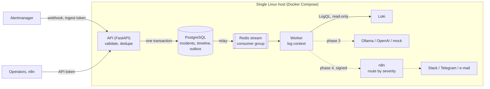

# AIOps Incident Engine

[](https://github.com/ali-fakhrabadi/aiops-n8n-incident-engine/actions/workflows/ci.yml)

An async Python service and a self-hosted n8n that turn Prometheus alerts into triaged
incidents: each alert is enriched with the matching Loki logs, analysed by an LLM
(local Ollama by default, OpenAI optional, or a deterministic mock for CI and reviewers)
for a probable root cause and **safe, read-only diagnostic commands**, and routed by n8n
to the right channel by severity. Everything runs on one Linux host; with Ollama, no
alert or log line leaves it.

> **Status: phase 2 of 5.** Alertmanager deliveries become idempotent incidents with a
> timeline; a worker fed through a transactional outbox and Redis Streams collects the
> redacted Loki log lines around each incident. The AI analysis and the n8n workflow
> follow in the next phases; see the [roadmap](#roadmap).

## Architecture



* **The API owns correctness**: validation, idempotency and incident state. **n8n will
  own routing**, where it is easiest to change: which channel, which format, who is on call.
* **LLM output will be advice, never action.** Suggested commands will pass an allowlist
  of read-only diagnostics and are never executed; logs are untrusted input to a prompt.

## From alert to incident

An **incident** is one occurrence of one alert: Alertmanager's fingerprint (the alert's
label set) plus the time it started firing. Alertmanager delivers at least once (it
retries, re-sends firing alerts every group interval, and an HA pair delivers from every
replica), so every delivery is safe to apply again:

| Delivery | Effect |
|---|---|
| A new alert, firing | Incident opened, `opened` on the timeline, `incident.opened` queued for the worker |
| The same alert again (repeat, retry, other replica) | Same incident: `last_received_at` and `notification_count` move, nothing else |
| The alert resolves | Status `resolved`, end time and duration recorded, `incident.resolved` queued |
| A late firing delivery for a resolved incident | Ignored for the status: a resolved incident is never reopened |
| The alert fires again later | A new start time, so a new incident |
| Already resolved on first sight | Recorded as resolved; nothing to investigate |
| The third opening of one alert within an hour | Flagged as **flapping** (threshold and window configurable) |
| `Watchdog`, `InfoInhibitor` | Ignored: heartbeats, not incidents |

Concurrent deliveries are safe: inserts use `ON CONFLICT DO NOTHING` and the loser
updates the winner's row under a row lock, alerts are processed in a fixed order so
concurrent batches cannot deadlock, and the test suite delivers the same batch five
times at once to prove it.

## Reliable hand-off to the worker

* **Transactional outbox.** The incident, its timeline event and the outbox row are
  committed together: an event is never lost when Redis is down, and never sent for a
  change that was rolled back. The API does not need Redis at all, so Alertmanager's
  deliveries succeed during a Redis outage; the API returns 503 only when PostgreSQL is
  down, which makes Alertmanager retry.
* **Relay.** The worker moves outbox rows to a Redis stream (`FOR UPDATE SKIP LOCKED`, so
  several workers share the work) and prunes published rows after seven days.
* **Consumer group with retries.** A failed message stays pending and is claimed again
  after `claim_idle_seconds` (`XAUTOCLAIM`), which also rescues the messages of a crashed
  worker. After `max_deliveries` attempts it moves to a dead-letter stream and the
  incident records the failure. Handlers are idempotent: their updates apply only to the
  state they expect.

## Log context

For each new incident the worker asks Loki for the lines of the workload that alerted,
from 15 minutes before the alert started to 2 minutes after (at most 200 lines), and
stores them on the incident. The first rule whose labels the alert has decides the
stream selector:

| Alert labels | Loki selector |
|---|---|
| `compose_project`, `compose_service` | `{compose_project="…", compose_service="…"}` |
| `container_label_com_docker_compose_project`, `…_service` (cAdvisor) | the same |
| `name` (container) | `{container="…"}` |
| `job` (a scrape target named after its service) | `{compose_service="…"}` |

Label values are escaped, so a crafted label cannot widen the query. Every line is
**redacted** before it is stored (URLs with credentials, bearer and basic auth, JWTs,
AWS keys, private keys, `password=`/`token:`-style pairs) and truncated to 2,000
characters. An alert no rule matches (a host disk alert, say) is marked `skipped`, an
empty window `empty`, a Loki that keeps failing `failed` after the retries.

Verified against the [observability stack's](https://github.com/ali-fakhrabadi/cloud-native-observability-iac)
real Loki: a `ContainerRestarting` alert for its Grafana container came back with the 19
Grafana log lines of the window, oldest first.

## API

Interactive documentation: `/docs` (OpenAPI). Every error is an RFC 9457
`application/problem+json` document carrying the request ID.

| Endpoint | Token | Purpose |
|---|---|---|
| `POST /api/v1/alerts/alertmanager` | ingest | Alertmanager webhook (version 4); body limit 1 MiB, 500 alerts |
| `GET /api/v1/incidents` | API | Newest first; filters `status`, `severity`, `alertname`, `flapping`; cursor pagination |
| `GET /api/v1/incidents/{id}` | API | Incident with labels, annotations, timeline and log context |
| `GET /health/live`, `/health/ready` | none | Process alive; PostgreSQL reachable and schema at the migration head |
| `GET /metrics` | metrics | Prometheus metrics of the API |

Each caller class has its own token (`secrets/ingest_token`, `api_token`,
`metrics_token`): Alertmanager can only deliver, Prometheus can only scrape, and a
leaked token exposes one capability. Alertmanager reads its token from a file:

```yaml
receivers:
  - name: aiops
    webhook_configs:
      - url: http://<host>:8020/api/v1/alerts/alertmanager
        send_resolved: true
        http_config:
          authorization:
            credentials_file: /run/secrets/aiops_ingest_token
```

The worker exposes its own metrics on port 9101 inside the Compose network: messages by
topic and outcome, handling time, outbox events published, log collections by result.

## Security baseline

* **Secrets are files**, mounted as Docker secrets (`make secrets`): never in `.env`,
  `docker inspect`, image layers or process arguments. Settings read `AIOPS_<NAME>_FILE`;
  PostgreSQL, Redis and n8n read theirs the same way.
* **Least-privilege database roles**: `aiops_owner` runs migrations; the API and the
  worker use `aiops_app`, which reads and writes data but cannot change the schema; n8n
  has its own database and cannot open the incident database. The smoke test proves it.
* **Hardened containers**: read-only root filesystems, all Linux capabilities dropped,
  `no-new-privileges`, non-root users, memory and CPU limits.
* **Network**: PostgreSQL and Redis sit on an internal network without internet access
  and are not published; the API and n8n listen on `127.0.0.1` only.
* **Untrusted input stays bounded**: request bodies over 1 MiB are refused even when sent
  chunked, label and annotation sizes are capped, unknown query parameters are rejected,
  and validation errors never echo the input.
* **n8n stays private**: telemetry, update checks, the template gallery and community
  packages are off, and workflows cannot read the container environment.
* **Supply chain**: hash-pinned dependencies (direct ones at least a week old when
  chosen), digest-pinned n8n image, actions pinned to commit SHAs, Dependabot.

## Quick start

Requirements: Docker with Compose v2, GNU make, bash, openssl, python3.

```bash
make env secrets     # .env with defaults, generated secrets in ./secrets
make up              # build, migrate, start; waits for health checks
make smoke           # end-to-end checks, including one alert through the whole pipeline
```

| Service | URL |
|---|---|
| API docs (Swagger UI) | http://127.0.0.1:8020/docs |
| n8n | http://127.0.0.1:5678 |

On a remote host, reach both through an SSH tunnel:
`ssh -L 8020:127.0.0.1:8020 -L 5678:127.0.0.1:5678 user@host`.

**Log context** needs a Loki. With the observability stack on the same host, add
`COMPOSE_FILE=docker-compose.yml:docker-compose.loki.yml` to `.env`: only the worker
joins that stack's network. For any other Loki, set `AIOPS_LOKI_URL`.

## Development

| Command | What it does |
|---|---|
| `make test` | Unit and integration tests with coverage, on a separate `aiops_test` database and Redis database 1, so the stack's data is never touched |
| `make lint` / `make format` | Ruff checks / fixes |
| `make typecheck` | Strict mypy over the code, tests and scripts |
| `make audit` | pip-audit of the locked runtime dependencies |
| `make ci` | All of the above, as CI runs them |
| `make lock` | Re-resolve and hash-pin `requirements*.txt` (`PIP_INDEX_URL` for a mirror) |
| `make revision MESSAGE="..."` | Autogenerate an Alembic migration |

97 tests, 96% branch coverage; CI also checks that the models and migrations agree
(`alembic check`) and runs the smoke test against the full stack.

## Roadmap

1. **Foundation** (done): service skeleton, container stack, migrations, probes,
   metrics, logging, CI.
2. **Alert ingestion and log context** (done): Alertmanager webhook, idempotent incidents
   with a timeline and flapping detection, transactional outbox, Redis Streams worker
   with retries and dead letters, redacted Loki context, query API.
3. **AI root-cause analysis**: Ollama, OpenAI and mock analysers over the collected
   context, validated structured output, command safety policy, prompt-injection
   defences.
4. **n8n workflow**: import-ready workflow (Webhook, Code, Switch, notification nodes),
   signed webhooks, delivery callbacks, `scripts/simulate_alert.py`, Alertmanager of the
   observability stack wired in.
5. **Measured results**: end-to-end latency and analysis quality on real fault drills,
   screenshots and final documentation.

## License

[MIT](LICENSE)
